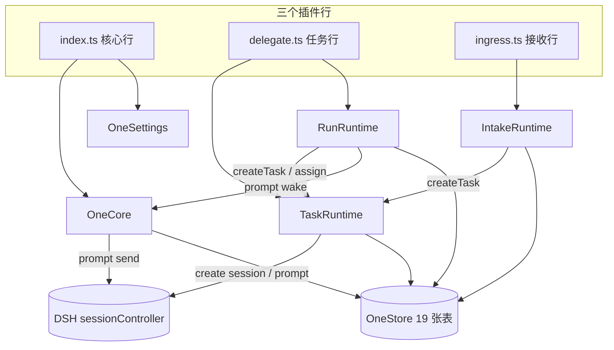

# DSH One 代码梳理与重构方案（讨论稿）

> 状态：**提案，未执行**。本文只做现状分析、目标架构与迁移路线，不改任何行为。
> 依据：DeepSeek Harness 团队的 Super-agent 设计（《Super-agent 设计探索：迈向更自主的 Agent 系统》）及其 MIT 原型 `deepseek-ai/dsh-superagent-prototype`（本地只读参考：`C:\git\agent\_ref_superagent`）。

---

## 0. 结论先行

dsh-one 现在**功能是齐的，但架构不是一套系统，是三套系统叠在一起**：

| 层 | 模块 | 它自己调度什么 |
|---|---|---|
| 事件层 | `IntakeRuntime` | Trigger → Thread → Eval → Decision → 创建 Task |
| 任务层 | `TaskRuntime` | Task → Assignment → Worker Session、租约、槽位、预算、恢复 |
| 目标层 | `RunRuntime` | Run → 多个 Task → 投影、重派发、唤醒用户 |

三层各自直接写库、各自有一套重试和状态推导。结果是：**同一件事有三套说法**（Task / Run / Eval），**同一个副作用有三条通道**（task input、run wake、intake confirm），且没有任何跨表事务。

对照 Super-agent 的参考实现，差距不在功能多少，而在**边界**：

1. **单一写者**：参考实现里 `Engine` 是 Trigger/Thread/Decision/Ticket/Assignment 的唯一写者，命令同步、每个命令一个事务；dsh-one 有 4 个模块直接写 `tasks`，14 处 `store.updateTask`、15 处 run 写入、38 处 intake 写入。
2. **副作用先落库后执行**：参考实现有 `Effects` 持久队列（launch / delivery / relay / notice / reply / assessment），一类副作用一个 handler、统一退避与健康；dsh-one 是三套手写重试。
3. **领域核心不碰 I/O**：参考实现 `src/core` 除 Node 哈希外不 import 任何外部模块；dsh-one 的 `TaskRuntime` 同时是状态机、调度器、会话工厂、租约管理器和提示词拼装器。

**建议：不重写，做 6 个阶段的绞杀式重构（strangler），每阶段独立可发布、测试全绿。** 目标不是"变成 dsh-superagent"，而是把它那套**领域边界**用到 dsh-one 的"通用工作区助手"定位上。

---

## 1. 参考架构摘要（Super-agent）

### 1.1 双层结构

- **Router（主 Session）**：承接人类交互、维护全局上下文、评估 Trigger、派发 Ticket、向人回复。不亲自做长活。
- **Worker（Executor Session）**：每个 Ticket 一个独立会话 + 独立目录，并发执行；不直接回复用户，只通过 Report 把状态和结果交回 Router。

### 1.2 四个特征

| 特征 | 含义 | dsh-one 现状 |
|---|---|---|
| 连续 | 跨 IM / GitHub 始终是同一个 Agent，同一任务连续推进 | 只有聊天一个入口；GitHub 是单向 intake |
| 高效 | Router 统一分派，多个 Worker 并发 | 有并发（maxWorkers + 租约），但按 cwd 串行 |
| 主动 | 持续监听环境事件，按规则自己找活干 | Ingress 有规则 + 评估，但仅 GitHub |
| 持久 | 云端状态 + Watchdog 自愈，设备休眠不掉线 | 有启动恢复，但没有 Watchdog / 健康模型 |

### 1.3 领域概念（参考实现 `docs/001-domain.md`）

```
Source ──Trigger──▶ Thread ──batch──▶ Eval ──Decision──▶ Ticket ──Assignment──▶ Executor
                        │                                  │
                        └──Subscription fan-out────────────▶│
                                                           └──Channel──▶ Source（回复）
```

| 概念 | 一句话 | dsh-one 对应物 |
|---|---|---|
| Source | 事件流（GitHub / 飞书 / 聊天），管读位置、自己过滤 | `IntakeRuntime` + `source/github.ts`（耦合） |
| Trigger | 一条不可变事件，审计与幂等单位 | `TriggerRecord`（已有，仅 GitHub） |
| Thread | 同一话题的 Trigger 序列，Eval 串行 | `ThreadRecord`（已有） |
| Eval / Decision | 程序规则闸门 + 模型研判 → 决定 | `EvalRecord` / `DecisionRecord`（已有） |
| Mandate | 一次接受的授权：策略版本、范围、强度 | `MandateRecord`（已有） |
| **Ticket** | **唯一的工作单元** | `TaskRecord`（名字不同，且被 Run 再包一层） |
| Assignment | Ticket 与一个 Executor 实例的绑定 | `TaskAssignment`（已有） |
| Report | Executor 的结构化汇报 | `TaskReport`（已有） |
| Channel | Thread 的写侧 | `WebChannel`（只有唤醒用，未泛化） |
| Policy | 版本化的准入规则 | `PolicyRecord`（已有） |
| **Effect** | **持久化副作用队列** | **缺失**（三套手写重试） |

### 1.4 三条最重要的设计不变量

1. **单一写者**：一种状态只有一个写者；其他人读或请它写。
2. **core 不碰 I/O**：领域规则可脱离宿主单测。
3. **副作用先落库，提交后再执行**：崩溃点任意，恢复后不丢不重。

这三条是这次重构真正要买的东西。

---

## 2. dsh-one 现状地图

### 2.1 规模

```
src 11,432 行 / 33 个文件        tests 3,124 行 / 15 个文件 / 139 个用例
```

| 文件 | 行数 | 实际职责 |
|---|---:|---|
| `src/client.ts` | 1,271 | 6 个插槽注册 + API 客户端 + 轮询 store + 6 个组件 + CSS + 设置表单 |
| `src/core/registry.ts` | 1,142 | 会话注册表 + 访问策略 + outbox/重试 + 模型选择 + 助手会话生命周期 + 审计 + 工作区概览 |
| `src/task/runtime.ts` | 1,067 | Task 状态机 + 调度器 + Worker 会话工厂 + 租约 + 槽位 + 预算 + 恢复 + 提示词拼装 |
| `src/types.ts` | 1,060 | 4 个子系统的全部类型，105 个导出 |
| `src/intake/runtime.ts` | 766 | GitHub 事件翻译 + 闸门 + 模型评估 + 决策 + 建 Task + 轮询 |
| `src/run/runtime.ts` | 763 | Run 状态机 + 投影 + 重派发 + 唤醒策略 + 活动流 |
| `src/core/tools.ts` | 566 | 5 个模型工具（含 schema 与渲染） |
| `src/panel/api.ts` | 553 | 20+ 条 HTTP 路由 |
| `src/store/spec.ts` | 441 | 19 张表 + zod schema |
| 其余 24 个文件 | ~3,800 | 设置、命令、工作区、来源、渠道、通知、工具、入口 |

### 2.2 运行时拓扑



**注意箭头**：四条线全部直接写同一个 Store，没有事务边界。

### 2.3 数据表分组

| 组 | 表 | 写者 |
|---|---|---|
| 核心 | `sessions` `outbox` `audit` `settings` | `OneCore` / `OneSettings` |
| 任务 | `tasks` `assignments(内嵌)` `leases` `reports` | `TaskRuntime` |
| 目标 | `runs` `run_activities` `run_wakes` | `RunRuntime` |
| 接收 | `triggers` `threads` `evals` `decisions` `policies` `mandates` `deliveries` `cursors` `subscriptions` | `IntakeRuntime` |

`tasks` 有两个写入口：`TaskRuntime.createTask`（本模块）与 `IntakeRuntime` 通过 `TaskService.createTask`；`runs` 又会反过来改 `tasks`（cancel）。

### 2.4 写者矩阵（问题核心）

| 状态 | 谁写 | 事务？ |
|---|---|---|
| `tasks` | `TaskRuntime`（14 处 updateTask） + `IntakeRuntime`（经 service 创建） + `RunRuntime`（经 service 取消） | 无跨表事务 |
| `leases` | `TaskRuntime` 独占 | 单表原子 |
| `runs` | `RunRuntime` 独占（15 处） | 单表原子 |
| `triggers/threads/evals/decisions/policies/mandates` | `IntakeRuntime` 独占（38 处） | 单表原子 |
| `sessions` | `OneCore` + `TaskRuntime.trustWorkerSession` + `IntakeRuntime`? | 无事务 |
| `outbox` | `OneCore` + `RunRuntime`（wake 通过 core.send） | 无事务 |

---

## 3. 问题清单（按严重度）

### P0 — 架构级，重构必须先解决

**P0-1 三个调度器并存。**
`TaskRuntime.pump` 决定"下一个跑哪个 Task"；`RunRuntime.tick/dispatch` 又决定"重派发哪个步骤"；`IntakeRuntime.processQueuedEvals` 决定"哪个 Eval 先跑"。三者共享 `maxWorkers` 语义却各自维护，且在 `run/runtime.ts:189` 与 `intake/runtime.ts:402` 两处直接 `createTask`。
→ 应合并为：**Engine 决定状态，Executor 决定槽位，Effects 决定"何时重试"**。

**P0-2 没有单一写者与跨表事务。**
`TaskRuntime` 里 14 处 `store.updateTask` 分散在 assign/report/control/lease/expire/recover 路径；`RunRuntime` 15 处直接写 `runs`；`IntakeRuntime` 38 处写接收域。
典型风险：task 标成 `done` 与 lease 释放、report 落库、run 投影更新是四个独立写；中途崩溃会留下"任务完成但租约还在 / 报告不在"的状态。
→ 应合并为：**每种聚合一个 Engine 命令，命令内部一个事务**。

**P0-3 副作用没有持久队列。**
三条通道各自重试：
- `TaskRuntime.deliverInput`：失败写 `promptStatus='unknown'`，靠 `turn/end` 兜底；
- `RunRuntime.deliverWake`：`run_wakes` 表 + 自己的 attempts/backoff；
- `IntakeRuntime.confirm`：直接 `send`，失败只记 audit。
三者语义不同，且"DB 已写、prompt 未发"的窗口没有统一恢复。
→ 引入 **Effects**：`launch / delivery / relay / notice / reply / assessment`，一类一个 handler，统一退避、顺序与健康。

**P0-4 `OneCore` 是上帝对象。**
1,142 行、22 个公开方法：会话注册表、访问策略、outbox、发送重试、模型选择、助手会话创建/复用/问候、工作区概览、审计。
→ 拆成：`SessionRegistry`、`Outbox`、`ModelRouter`、`AssistantLifecycle`、`AuditLog`。

### P1 — 结构性

**P1-1 `types.ts` 是一个 1,060 行 / 105 导出的"公共大桶"。** 四个子系统的类型互相可见，没有边界。
**P1-2 `client.ts` 1,271 行单闭包。** 组件、轮询、CSS、API、设置表单不可单测，只能整体加载。
**P1-3 Source 抽象缺失。** `DispatchEvent` 的 `kind` 是 GitHub 事件名；`IngressConfig` 里全是 `repositories/webhookPath/secretEnv`。加飞书/IM 必须改 intake 核心。
**P1-4 Worker 执行模型弱。** 现在是"一个 cwd + 租约"，没有 per-ticket 目录/worktree、prepare 命令、后台 jobs/subagents 跟踪、30 分钟静默规则。并行度被 cwd 锁死。
**P1-5 Prompt 没有分层。** Worker 提示词硬编码在 `task/runtime.ts:workText()`；Router 只有一段 `persona.ts`。没有版本、没有按角色分节、没有覆盖与回滚。
**P1-6 没有 Watchdog / 健康模型。** 只有 lease heartbeat；没有"哪个 worker 卡住了/偏离目标/接口报错"的独立控制回路。

### P2 — 卫生

- 命名漂移：Run / Task / Goal / Ticket / 任务 / 目标 在不同层指同一件事。
- `lib/` 构建产物入库；工作区有 30+ 未提交改动（上一轮 run UI）。
- 测试全是 fake host；真实 DSH 的 strict schema 变更无契约测试覆盖。

---

## 4. 目标架构

### 4.1 领域模型（映射到 dsh-one 的产品语义）

```
用户（聊天）
   │  message
   ▼
Source(chat) ─Trigger─▶ Thread ─Eval─▶ Decision ─▶ Goal(可选)
                                                      │ 1..N
                                                      ▼
                                                   Ticket ─Assignment─▶ Executor(Worker Session)
                                                      │                    │
                                                      │◀──── Report ───────┘
                                                      └─ Channel ─▶ 回复/通知
```

- **Goal（目标）**：用户可见的一层聚合（"把这个仓库的 X 做完"），只做分组与展示，**不再拥有调度器**。
- **Ticket（工单）**：唯一工作单元。现在的 `TaskRecord` 就是它，改名即可。
- **Assignment（派工）**：一次 worker 会话尝试。现有 `TaskAssignment` 已接近。
- **Report（报告）**：结构化状态。现有 `TaskReport` 已接近。
- **Trigger / Thread / Eval / Decision / Mandate**：现有接收域，保留，但把 `Source` 抽象出来。
- **Effect（副作用）**：新增，所有"提交后要做的事"都走它。

### 4.2 模块布局

```
src/
  core/                      # 纯领域，零 I/O
    model.ts                 # Trigger/Thread/Ticket/Assignment/Report/Decision/Mandate/Stage
    engine.ts                # 唯一写者；每个命令一个事务
    parts/
      intake.ts  evals.ts  tickets.ts  assignments.ts  replies.ts
    stage.ts                 # Ticket 阶段表（person/*, working/*, idle）
    errors.ts  reasons.ts  ids.ts
  app/                       # 组合与适配
    runtime.ts               # composition root
    store.ts                 # SQLite/KV 仓储 + atomic()
    effects.ts               # 持久副作用队列 + 健康
    outbox.ts                # 回复回执
    sessions.ts              # Router/Executor 两种角色的 Session 适配
    executor.ts              # Worker 会话、目录、槽位、后台 jobs/subagents
    assessor.ts              # 模型研判（从 intake 抽出）
    prompts.ts               # 分角色、分节、版本化
    health.ts                # Watchdog / HealthBoard
    panel/                   # HTTP + views
  sources/
    kind.ts  registry.ts
    chat/                    # 助手会话本身作为一个 Source
    github/
    manual/                  # 人类命令
  client/                    # 面板 UI（从 client.ts 拆出）
    index.tsx  api.ts  state.ts  components/  styles.ts
  index.ts  delegate.ts  ingress.ts
```

### 4.3 依赖规则（用测试强制）

| 规则 | 检查方式 |
|---|---|
| `src/core/**` 不得 import `src/app/**`、`src/sources/**`、`node:fs`、`node:http` | 静态 import 扫描测试 |
| `src/sources/**` 不得 import `src/app/**` | 同上 |
| `src/client/**` 只能 import 类型（`import type`） | 同上 |
| 一张表只能有一个写者模块 | 写者清单测试（表名 → 模块） |
| 所有 `core` 命令同步、且在一个 `atomic()` 内 | 代码评审 + unit test |

### 4.4 Ticket 阶段表（直接采用参考实现）

| Stage | 条件 | 面板文案 |
|---|---|---|
| person/delivery | Input 投递失败 | 投递失败 |
| person/answer | 有 Attention（结构化提问） | 等待回答 |
| person/review | 最新 Report = ready | 等待验收 |
| person/blocked / failed | 最新 Report = blocked/failed 且之后无人回复 | 受阻 / 失败 |
| working/queued | 无 Assignment 或 pending | 排队中 |
| idle | 最新 Report = waiting，或 Assignment 结束 | 等待触发 |
| working | 其他 | 执行中 |

### 4.5 Effect 种类

| kind | 做什么 | 重试 |
|---|---|---|
| `launch` | 启动一个 Assignment（建会话、prepare 目录） | 5s 起倍增到 300s，3 次 |
| `delivery` | 把 Ticket 的等待 Input 交给运行中的 Assignment | 2s 起倍增到 60s |
| `relay` | 把 Report/问题转给 Router 会话 | 2s 起倍增到 60s，保序 |
| `notice` | 向 Router 注入通知（不唤醒） | 同上 |
| `reply` | 通过 Channel 回复人 | 5s 起倍增到 300s，保序 |
| `assessment` | 让 Router 评估候选 Trigger | 2s 起倍增到 60s |

---

## 5. 现状 → 目标 映射表

| 现有 | 目标 | 迁移动作 |
|---|---|---|
| `TaskRecord` | `TicketRecord` | 改名；存储键 `taskId` 保留，加 `ticketId` 别名迁移 |
| `TaskAssignment` | `Assignment` | 基本不动 |
| `TaskReport` | `Report` | 基本不动 |
| `TaskInput` | `Input` | 从 task 内嵌数组抽出为独立概念（可仍存行内） |
| `LeaseRecord` | Phase 4 前的 WorkerSlot；长期改 per-ticket 目录 | 分两阶段 |
| `RunRecord` | `GoalRecord` | 去掉 `status/paused/seen/attention` 等调度字段，保留展示字段；状态由 Ticket 投影 |
| `RunActivityRecord` | `ActivityRecord`（只读投影） | 保留 |
| `RunWakeRecord` | `Effect(relay)` | 删除表，迁移为 effect 行 |
| `IntakeRuntime` | `Source(github)` + `Eval` + `Engine` 命令 | 拆三块 |
| `TaskRuntime` | `TicketEngine` + `Executor` + `TicketProjection` | 拆三块 |
| `RunRuntime` | `GoalProjection` + `RouterNotifier` + `Executor.redispatch` | 拆三块 |
| `OneCore` | `SessionRegistry` + `Outbox` + `ModelRouter` + `AssistantLifecycle` + `AuditLog` | 拆五块 |

**工具名不变**：`one_task_*` / `one_run_*` 对外保留（模型和用户的习惯），只是内部换成同一套 Ticket 引擎。旧数据用迁移脚本升级。

---

## 6. 迁移路线（6 个阶段）

> 原则：每一步都能单独发布；`npm test` 必须全绿；旧路径以适配器保留，直到新路径覆盖。

### Phase 0 — 基线冻结（0.5 天）
- 先把上一轮未提交的 run UI 改动收成一个 commit（或 stash）。
- 建立 `docs/` 与 import 边界检查脚本（先只报告不阻断）。
- 用现有 139 个测试做"行为基线"。
- 验收：`git status` 干净、`npm test` 139/139、边界报告生成。

### Phase 1 — 类型拆分与领域模型（1–2 天）
- `types.ts` 拆为 `src/core/model.ts` + `src/app/dto.ts` + `src/client/types.ts`。
- `TaskRecord` 加 `ticketId` 读兼容，新增 `stage` 派生函数。
- 写 `docs/001-domain.md`（dsh-one 自己的术语表）。
- 验收：类型无循环依赖；139 测试不改逻辑通过；新增 stage 表单测。

### Phase 2 — Engine 单一写者（3–4 天）
- 新建 `src/core/engine.ts`，把 `TaskRuntime` 的状态迁移搬进去（同步、单事务）。
- `TaskRuntime` 退化为 `Executor` + 投影；`RunRuntime` 退化为 `GoalProjection`。
- 删除 `store.updateTask` 在非 Engine 模块的调用（用测试强制）。
- 验收：所有任务状态变化经 Engine；旧测试全绿；新增"崩溃点"测试（在事务中途模拟中断）。

### Phase 3 — Effects + Outbox 统一（3–4 天）
- 实现 `src/app/effects.ts`，迁移 `run_wakes`、task input 投递、intake confirm 到 effect。
- 统一退避/顺序/健康；`/api/health` 暴露。
- 验收：kill -9 恢复测试；同一 effect 不会重复执行；顺序测试。

### Phase 4 — Router / Worker 分离（4–5 天）
- `Sessions` 支持 router/executor 两种角色（模型、preset、prompt 分离）。
- `Executor` 接管 worker 会话：**Worker 由 agent 选择**——复用某个工作区里已有的会话，或让助手选文件夹新建工作区/会话；会话自己的 cwd 就是隔离单位。
- 会话级串行：同一个 worker 会话同一时间只接一个 Assignment；不同会话天然并行。
- 后台 jobs/subagents 跟踪、空闲回收、worker 崩溃恢复。
- 助手会话（Router）只保留路由/评估/回复工具。
- 验收：助手能把两个工单派给两个不同工作区的会话并行推进；worker 崩溃自动恢复；Router 不被长命令卡住。

### Phase 5 — Source 协议 + GitHub 迁移（3–4 天）
- 定义 `SourceKind`（identity/config/schema/scope/channel/threadContext/find/policy/health）。
- `IntakeRuntime` 拆成 `SourceRegistry` + `GitHubSource` + `Eval`。
- 把"助手聊天"注册为 `Source(chat)`：用户消息 → Trigger → Eval → Ticket 或直接回复。
- 验收：新增一个假 Source（内存事件）不改核心；GitHub 行为与现在一致。

### Phase 6 — 客户端拆分与助手视觉（2–3 天）
- `client.ts` 拆成 `client/index.tsx`、`api.ts`、`state.ts`、`components/`、`styles.ts`。
- 常驻身份条/徽标（上一轮已加）迁到新结构。
- 面板做成参考实现的"概览 / 工单 / 触发 / 设置 / 提示词"五页。
- 验收：组件可单测（用 fake React）；普通会话零影响。

### 可选 Phase 7 — Super-agent 增强（下一轮）
- Watchdog Session（独立 LLM 控制回路）。
- Chain of Recall / Inline & Spill（上下文记忆）。
- 投机执行（按环境信号预启动）。
- IM / 飞书 Channel。

---

## 7. 质量护栏

1. **import 边界测试**：`tests/architecture.test.mjs` 扫描 `src/**` 的 import，违反依赖规则即失败。
2. **写者清单测试**：`table → allowed writer module` 映射，任何模块 import 其他表的写方法即失败。
3. **契约测试**：对 `sessionController` / `storageDomain` 的真实 schema 做快照（用当前 desktop 的 rc.5 导出），防止上游 strict schema 变更悄悄打断。
4. **崩溃测试**：每类 effect 在"落库后、执行前"注入崩溃，重启后断言恰好一次。
5. **黄金提示词测试**：Router / Worker prompt 的固定段落做快照，改提示词必须显式更新快照。

---

## 8. 已定决策（2026-11-05）

1. **产品定位**：**通用工作区助手**。聊天是主入口，可服务任意工作区；GitHub、IM 都只是可插拔 Source。
2. **Worker 来源**：**由 agent 自己决定**。可以复用其他工作区里已有的会话，也可以自己选文件夹新建工作区/会话。会话自己的 cwd 就是隔离单位，不需要 worktree。
3. **目标层**：**保留目标，但降为纯分组/投影**，不再拥有调度器、状态机和重试。
4. **Effects**：**本轮就做，P0**。launch / delivery / relay / notice / reply / assessment 六类统一进持久队列。
5. **客户端形态**：**聊天为主 + 完整工作台面板**。聊天保持 DSH 原生会话与插件 chrome，另加概览/工单/来源/设置页面。
6. **对外工具面**：**收敛成统一入口工具**。初版为 `one_work`（create/assign/report/answer/complete/stop）+ `one_status`。
7. **执行方式**：**删库重建**。旧实现已归档到 git tag `legacy-0.2.0`，新基座从零开始。

### 基座 v0.3.0-alpha.0 已落地

- `src/core/model.ts` — Ticket / Goal / Assignment / Report / Attention
- `src/core/stage.ts` — Ticket 阶段表
- `src/core/engine.ts` — 同步、单写者、每个命令一次写入
- `src/app/effects.ts` — 持久副作用队列（去重、退避、顺序）
- `src/app/store.ts` — 内存版端口（下一阶段绑定 `ctx.storageDomain`）
- `src/app/tools.ts` — `one_work` / `one_status`
- 63 个测试全绿

### 实施进度（0.3.0-alpha.0）

| 阶段 | 状态 | 产出 |
|---|---|---|
| A 持久化 | ✅ | `dsh_one_v3` 域、`Store`、Engine 异步化、38 个测试 |
| B Executor | ✅ | Session 适配器、Worker 派发、槽位、恢复、Effects 接线 |
| C 助手 | ✅ | 身份注入、设置、`/one` 命令、助手会话 |
| D 客户端 | ✅ | 助手/工作台入口、身份条、工作台面板、HTTP API |
| E 收尾 | ✅ | README、打包、构建验证 |

累计测试：63 个（`npm test` 全绿）。

### 仍需决定（下一轮）

- **Watchdog / 主动触发**：本轮先做健康检查，LLM Watchdog 放到后面的阶段。
- **持久化后端**：已绑定 `ctx.storageDomain`（域 `dsh_one_v3`），内存兜底保留。
- **Source 协议**：当前 Source 只有"聊天 + 人类命令"；GitHub/IM 作为后续 Source 插件。

---

## 9. 明确不做

- **不直接照搬 `dsh-superagent-prototype`**：它是"单仓库 GitHub 代理"，15,205 行，领域和 dsh-one 的"工作区助手"不同；照搬会把产品带偏。只借架构，不借产品。
- **不在本轮做 IM / 飞书 / 投机执行 / Chain of Recall**：先把核心边界立住。
- **不做大爆炸式重写**：6 个阶段，每阶段可回滚。

---

## 附：参考实现模块对照（便于查阅）

| 参考实现 | 作用 | dsh-one 对应 |
|---|---|---|
| `src/core/engine.ts` | 唯一写者 + 角色接口 | 待建 |
| `src/core/parts/*` | Intake / Evals / Tickets / Assignments / Replies | 分散在 IntakeRuntime / TaskRuntime |
| `src/core/stage.ts` | Ticket 阶段表 | 待建（现在状态散在 TaskRecord.status） |
| `src/app/effects.ts` | 持久副作用队列 | 待建 |
| `src/app/outbox.ts` | 回复回执与顺序 | `OneCore.send` 的 outbox 部分 |
| `src/app/sessions.ts` | Router/Executor Session 管理 | `OneCore` + `TaskRuntime` 拼装 |
| `src/executor/dsh.ts` | Worker 会话/目录/槽位/后台任务 | `TaskRuntime` 的会话部分 |
| `src/app/prompts.ts` | 分角色分节版本化提示词 | `persona.ts` + `workText()` |
| `src/sources/kind.ts` | Source 协议 | 缺失 |
| `src/app/health.ts` + `infra/health.ts` | Watchdog / 健康板 | 缺失 |
